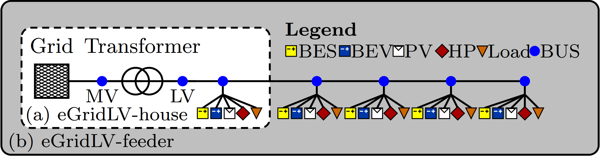

<p float="left">
    
</p>

[](https://www.python.org/downloads/release/python-3918/)
[](./LICENSE)
[](https://github.com/psf/black)
[](https://doi.org/10.1145/3777518.3777526)

<h1 align="center">Multi-Objective Reinforcement Learning with Shielding for Control and Safety in Power Grids</h1>

**⚠️ Note**: _Last update on 19.12.2025_

This repository contains the Python implementation of our paper: **Multi-Objective
Reinforcement Learning with Shielding for Control and Safety in Power Grids**.
It simulates a low-voltage grid that includes the control of photovoltaic (PV) inverters,
battery energy storage system (BES) inverters, battery electric vehicle (BEV) chargers,
and heat pumps (HP). Several generation and load profiles as well as dynamic EPEX spot
market prices are included.

## 1. Introduction

<details>
  <summary>Click to expand/collapse</summary>

### **1.1 Description**

The environment is developed using the
**[Gymnasium](https://github.com/Farama-Foundation/Gymnasium)** library, and integrates
the **[stable-baselines3](https://github.com/DLR-RM/stable-baselines3)** and
**[stable-baselines3-contrib](https://github.com/Stable-Baselines-Team/stable-baselines3-contrib)**
libraries for reinforcement learning. Multi-objective environments are built with
**[MO-Gymnasium](https://github.com/Farama-Foundation/MO-Gymnasium)**, using MORL
algorithms from **[MORL-Baselines](https://github.com/LucasAlegre/morl-baselines)**
library.

The following environments (problem settings) are available:

- **eGridLV-household-economic-v0**: Single household scenario including PV, BES, EV,
  and HP with dynamic market prices. Optimizing for economic cost and BEV charge
  flexibility.
- **eGridLV-feeder-economic-v0**: Multi-household feeder grid with bus nodes, each
  including different PV, BES, EV, and HP components. Optimizing for economic cost and
  BEV charge flexibility.
- **eGridLV-feeder-voltage-v0**: Multi-household feeder grid with bus nodes, each
  including different PV, BES, EV, and HP components. Optimizing for voltage stability
  through reactive power control.
- **eGridLV-feeder-v0**: Multi-household feeder grid with bus nodes, each including
  different PV, BES, EV, and HP components. Optimizing for economic cost, BEV
  flexibility, voltage stability, and transformer/line loading.
- All environments are also available in **"mo-eGridLV-[...]"** version, which
  implements the mo-Gym interface for multi-objective RL (MORL) optimization, returning
  a vector of rewards.

<p align="center">
  
</p>
<p align="center"><strong>Fig. 1:</strong> Visualization of the eGridLVGym with single- and multi-objective environment versions.</p>

#### Key Features

- **Partially Observable Environment**: The agent cannot fully observe the grid state
  but instead receives partial information through noisy sensors (i.e., measurements).
  These include noisy short-term predictions for PV generation, static loads, and market
  prices.
- **Multi-Objective Optimization**: The agent optimizes for several conflicting
  objectives simultaneously to balance trade-offs between cost minimization, grid
  stability, and efficiency, while also incorporating penalties for soft constraint
  violations. These objectives are combined into a single reward function for
  single-objective (SORL) environments, or returned as a vector for multi-objective
  (MORL) environments.
- **Power Flow Calculation**: The environment contains a power flow simulation
  (PandaPower) to model the grid's electrical behavior, including voltage, component
  loading, and line losses. This allows detailed analysis of grid constraints and
  stability.
- **Customizable Observation and Action Spaces**: The environment provides different
  observation and action spaces for each use case. The action space contains active
  power (P) and reactive power (Q) control setpoints of DERs, with a total dimension
  that depends on the number and type of controllable devices (e.g., energy storage, EV
  charging, or PV control).
- **Reinforcement Learning Algorithms**: The environment supports a wide variety of
  advanced reinforcement learning algorithms, supporting MORL and SORL to explore
  optimal control strategies in this complex, multi-objective, partially observable
  setting. Additional rule-based controllers are available as a baseline comparison.

</details>

## **2. Installation and Environment Setup**

<details>
<summary>Click to expand/collapse</summary>

1. **Clone this repository**:

   ```bash
   git clone https://github.com/KIT-IAI/eGridLVGym
   ```

   Set up either a SORL or MORL environment, depending on your use case:

   ##### SORL Setup:

   ```bash
   python3.9 -m venv SORL_ENV
   source SORL_ENV/bin/activate
   pip install --upgrade pip
   ```

   ```bash
   cd ~/eGridLVGym
   pip install -r requirements_sorl.txt
   pip uninstall egridlv-gym -y
   pip install -e .
   ```

   ##### MORL Setup:

   ```bash
   python3.9 -m venv MORL_ENV
   source MORL_ENV/bin/activate
   pip install --upgrade pip
   ```

   ```bash
   cd eGridLVGym
   pip install -r requirements_morl.txt
   pip install ./egridlv_gym
   ```

   Depending on your CUDA version, you might need another version of PyTorch. During
   development the following version was used: `torch==2.5.1+cu121`, available at:

   ```bash
   pip install torch torchvision torchaudio --index-url https://download.pytorch.org/whl/cu121
   ```

1. **Quick Start**:

   Train a model using **[stable-baselines3](https://github.com/DLR-RM/stable-baselines3)** on a
   vectorized environment:

   ```python
   from stable_baselines3.common.env_util import make_vec_env
   from stable_baselines3 import SAC

   import egridlv_gym

   env = make_vec_env(
       "egridlv_gym:eGridLV-household-economic-v0",
       n_envs=4,
       seed=0,
       env_kwargs={"render_mode": None},
   )

   model = SAC(
       "MlpPolicy",
       env,
       verbose=1,
       stats_window_size=10,
       learning_starts=96,
       use_sde=True,
   )

   # Train the model for 1000 episodes (this may take a while)
   model.learn(total_timesteps=672 * 1000)

   model.save("sac_eGridLV-household-economic-v0")

   # Runs the trained model for one episode, this will produce no output
   vec_env = model.get_env()
   obs = vec_env.reset()
   for i in range(672):
       action, _state = model.predict(obs, deterministic=True)
       obs, reward, done, info = vec_env.step(action)

   ```

   </details>

## **3. Command-line Arguments**

<details>
<summary>Click to expand/collapse</summary>

#### **3.1 Training Scripts**

To train a SORL algorithm, use the **[train.py](train.py)** script, with the following
arguments:

| Argument                | Type  | Default Value    | Choices                                                                      | Help                                                      |
| ----------------------- | ----- | ---------------- | ---------------------------------------------------------------------------- | --------------------------------------------------------- |
| `--algorithm`           | str   | `ppo`            | `ppo`, `sac`, `ddpg`, `td3`, `a2c`, `tqc`, `trpo`, `recurrent_ppo`           | The RL algorithm (from stable_baselines3 or sb3_contrib). |
| `--episodes`            | int   | `8000`           | integer                                                                      | Number of episodes to train for.                          |
| `--num-envs`            | int   | `4`              | integer                                                                      | Number of environments to run in parallel.                |
| `--usecase`             | str   | `feeder-voltage` | `household-economic`, `feeder-economic`, `feeder-voltage`, `feeder-combined` | The use case to train on.                                 |
| `--seed`                | int   | `42`             | `0`–`inf`                                                                    | Random number generator seed.                             |
| `--eval-freq`           | int   | `500`            |                                                                              | Evaluation frequency (in number of episodes).             |
| `--curtailment-scaling` | float | `1.0`            | Float                                                                        | Scaling factor for the curtailment reward.                |

##### **3.1a Example Training - Using Command Line**:

```bash
python train.py --algorithm sac --episodes 8000 --num-envs 4 --use-case feeder-combined
```

##### **3.1b Example Training - Using SLURM**:

```bash
chmod +x slurm_scripts/run_training.sh
sbatch ./slurm_scripts/run_training.sh sac 8000 4 feeder-combined
```

#### **3.2 Evaluation Scripts**:

To evaluate a trained model, use the **[evaluation.py](evaluation.py)** script, with the
following arguments:

| Argument                         | Type | Default Value                                  | Choices                                                                                                                     | Help                                                                                   |
| -------------------------------- | ---- | ---------------------------------------------- | --------------------------------------------------------------------------------------------------------------------------- | -------------------------------------------------------------------------------------- |
| `--algorithm`                    | str  | `ppo`                                          | `ppo`, `sac`, `td3`, `ddpg`, `a2c`, `tqc`, `trpo`, `recurrent_ppo`, `bench_nothing`, `bench_price_window`, `bench_residual` | RL algorithm to evaluate (from stable_baselines3, sb3_contrib, or rule-based control). |
| `--envs`                         | int  | `4`                                            | `1`,`2`,`3`,`4`                                                                                                             | Number of parallel environments to run. Must match the training setup.                 |
| `--no-normalization`             | bool | `False`                                        | `True`, `False`                                                                                                             | Disable environment normalization (useful for rule-based controllers).                 |
| `--usecase`                      | str  | `household-economic`                           | `household-economic`, `feeder-economic`, `feeder-voltage`, `feeder-combined`                                                | The use case to evaluate.                                                              |
| `--obs-space`                    | str  | `box`                                          | `box`, `dict`                                                                                                               | Observation space: `box` (default) or `dict` (e.g., for RBC).                          |
| `--folder`                       | str  | `./models/feeder-combined/best_a2c/best_model` | `Path`                                                                                                                      | Optional path to the model folder.                                                     |
| `--seed`                         | int  | `58`                                           | `0`–`inf`                                                                                                                   | Random seed for the environment.                                                       |
| `--enable_shielding`             | bool | `False`                                        | `True`, `False`                                                                                                             | Enable reactive power control (shielding).                                             |
| `--enforce_hard_grid_constraint` | bool | `False`                                        | `True`, `False`                                                                                                             | Enforce critical grid constraints (e.g., transformer load).                            |

##### **3.2a Evaluation Scripts - Using Command Line**:

```bash
python evaluation.py --algorithm ddpg --envs 4 --usecase feeder-combined --folder ./models/feeder-combined/best_ddpg/best_model.zip --seed 64
python evaluation.py --algorithm ddpg --envs 4 --usecase feeder-combined --folder ./models/feeder-combined/best_ddpg/best_model.zip --enforce_hard_grid_constraint --seed 64
python evaluation.py --algorithm ddpg --envs 4 --usecase feeder-combined --folder ./models/feeder-economic/best_ddpg/best_model.zip  --enable_shielding --seed 64
python evaluation.py --algorithm ddpg --envs 4 --usecase feeder-combined --folder ./models/feeder-economic/best_ddpg/best_model.zip  --enable_shielding --enforce_hard_grid_constraint --seed 64
```

##### **3.2b Evaluation Scripts - Using SLURM**:

```bash
chmod +x slurm_scripts/run_evaluation.sh
slurm_scripts/run_evaluation.sh a2c 4 feeder-combined
```

#### **Multi-Objective Training and Evaluation**:

For multi-objective training and evaluation, use the **[train_mo.py](train_mo.py)** and
**[evaluation_mo.py](evaluation_mo.py)** scripts, respectively. As morl-baselines
currently does not support parallel environments, the number of environments is set to
1\. The logging also follows a different format and requires a wandb account. If you want
to use it with the SLURM scripts, please edit `slurm_scripts/run_training_mo.sh` and
`slurm_scripts/run_evaluation_mo.sh` accordingly with your API key. Currently only CAPQL
is supported for multi-objective training; to add other models edit the `train_mo.py`
script.

</details>

<h2>Citation &#128221;</h2>
<p>
If you use this framework in your research, please consider citing our paper &#128221; and giving the repository a star &#11088;:
</p>

```bibtex
@article{Demirel2025_MORL,
    author = {Gökhan Demirel and Simon Grafenhorst and Jakob Ohm and Benjamin Schäfer and Kevin Förderer and Veit Hagenmeyer},
    title = {Multi-Objective Reinforcement Learning with Shielding for Control and Safety in Power Grids},
    year = {2025},
    issue_date = {September 2025},
    publisher = {Association for Computing Machinery},
    address = {New York, NY, USA},
    volume = {5},
    number = {3},
    url = {https://doi.org/10.1145/3717413.3717427},
    doi = {10.1145/3717413.3717427},
    journal = {SIGENERGY Energy Inform. Rev.},
    month = dec,
    pages = {93–104},
    numpages = {12},
    keywords = {multi-objective reinforcement learning, energy management, voltage control}
}
```

## License

This code is licensed under the [MIT License](LICENSE).
